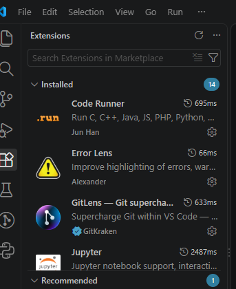
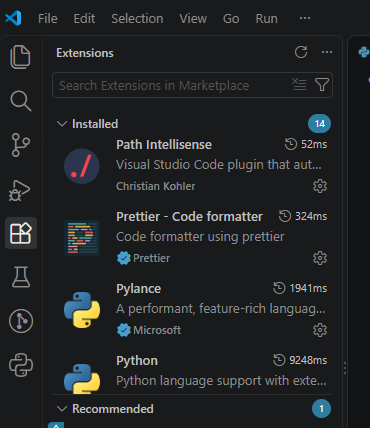

# AI-Lab通识学习计划与环境踩坑记录
## 环境配置
*VSCode
*Python3.14
*GitHub
## 排错记录
| 遇到的问题 | 解决方法 |
| :--- | :--- |
|Markdown标题语法未生效，预览仍为普通文本|在标题的“#”后加空格|
|VSCode新建`.py`文件后代码无高亮显示|安装Python插件并重启VSCode|
|运行时报`UnicodeEncodeError:'gbk'codec`错误|在代码开头添加三行，将标准输出编码设为UTF-8(见下方代码块)
```python
import sys
import io
sys.stdout=io.TextIOWrapper(sys.stdout.buffer,encoding='utf-8')
```
## 代码实验



## 文献摘记
[廖雪峰的python教程](https://www.liaoxuefeng.com/wiki/1016959663602400)                                                                                    